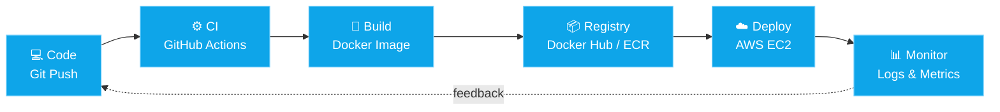

<div align="center">


<a href="https://git.io/typing-svg">
  
</a>

<br/><br/>


</div>

---

## ☁️ `whoami`

```bash
anjali@cloud:~$ cat about.txt

Name       : Anjali Gurjar
Role       : Student | Cloud & DevOps Enthusiast
Focus      : AWS, Docker, Linux, CI/CD, Infrastructure Automation
Background : Full-stack (React + Node) -> now going deep on how apps get shipped & run
Mindset    : "If you do it twice, automate it."
Status     : Learning in public, building hands-on labs, open to opportunities
```

I started out building web apps, and that curiosity pulled me toward the question I find more exciting: **how does code actually get built, containerized, deployed, scaled and monitored?** That is the world I'm diving into now.

---

## 🧰 Tech Stack

<div align="center">

### ☁️ Cloud & Infrastructure


### 🐳 Containers & Automation


### 🌱 Currently Exploring


### 💻 Development Background


</div>

---

## 🔄 The Pipeline I'm Learning to Build



---

## 🚀 Featured Project

### 🔗 Connectify

<div align="center">
  <a href="https://github.com/anjali972/connectify">
    
  </a>
</div>

A connectivity-focused full-stack web application, and my sandbox for practicing real deployment workflows.

| Layer | Technology |
|-------|------------|
| Frontend | React.js |
| Backend | Express.js, Node.js |
| Database | MongoDB |
| DevOps track | Docker, AWS, CI/CD (in progress) |

**🛠️ DevOps upgrades I'm working on for it:**

- [ ] 🐳 Containerize frontend and backend with Docker
- [ ] 🧩 Orchestrate services with Docker Compose
- [ ] ⚙️ Automated build and test pipeline with GitHub Actions
- [ ] ☁️ Deploy on AWS EC2 behind Nginx
- [ ] 📊 Add basic logging and monitoring

🔗 **Code:** [github.com/anjali972/connectify](https://github.com/anjali972/connectify)

---

## 🗺️ My Cloud & DevOps Roadmap

| Area | Focus | Status |
|------|-------|--------|
| 🐧 **Linux** | Shell, permissions, processes, networking, systemd | 🟢 Hands-on |
| 🐳 **Docker** | Images, containers, volumes, Compose | 🟢 Hands-on |
| ☁️ **AWS** | EC2, S3, IAM, VPC basics | 🟡 Learning |
| ⚙️ **CI/CD** | GitHub Actions pipelines | 🟡 Learning |
| 🌐 **Nginx** | Reverse proxy, serving apps | 🟡 Learning |
| 🏗️ **Terraform** | Infrastructure as Code | 🔵 Up next |
| ☸️ **Kubernetes** | Pods, deployments, services | 🔵 Up next |
| 📊 **Monitoring** | Prometheus, Grafana, CloudWatch | 🔵 Up next |

---

## 📊 GitHub Stats

<div align="center">


</div>

---

## 📈 Contribution Activity


---

## 🎯 Currently

```yaml
building:   Connectify, now with Docker + CI/CD
learning:   AWS core services, GitHub Actions, Nginx
next_up:    Terraform and Kubernetes
looking_for:
  - Cloud / DevOps internships
  - Junior DevOps or Cloud Engineer roles
  - Open-source and collaboration opportunities
```

---

## 🤝 Let's Connect

<div align="center">

[](https://www.linkedin.com/in/anjali-gurjar-90934a31a)
[](mailto:gurjaranjali677@gmail.com)
[](https://github.com/anjali972)

<br/>

*"The cloud is just someone else's computer, and I'm learning to run it really well."* ☁️

</div>


