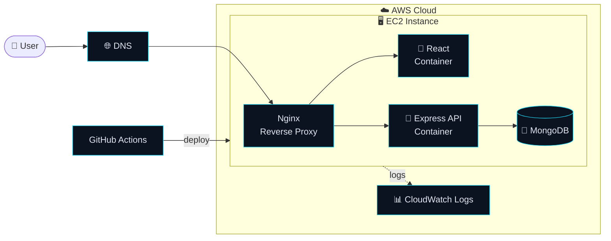
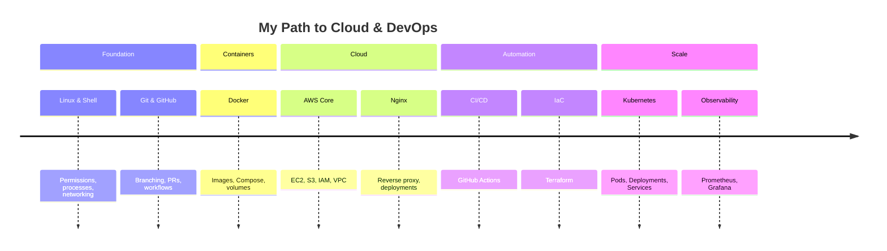

<div align="center">


<a href="https://git.io/typing-svg">
  
</a>

<br/><br/>


<br/>


</div>


<br/>

## ⚡ `$ whoami`

<table>
<tr>
<td width="55%" valign="top">

```bash
anjali@cloud:~$ cat profile.yaml

name:      Anjali Gurjar
role:      Cloud & DevOps Enthusiast
status:    Student, learning in public
focus:
  - Cloud infrastructure on AWS
  - Containers with Docker
  - Linux administration
  - CI/CD automation
  - Infrastructure as Code
motto:     "If you do it twice, automate it."
uptime:    99.9% coffee-powered ☕
```

</td>
<td width="45%" valign="top">

```text
   ☁️  ~ ~ ~ ☁️  ~ ~ ~ ☁️
 ┌──────────────────────────┐
 │  git push                │
 │    ↓                     │
 │  CI pipeline  ✅         │
 │    ↓                     │
 │  docker build 🐳         │
 │    ↓                     │
 │  deploy to AWS 🚀        │
 │    ↓                     │
 │  monitor & repeat 📊     │
 └──────────────────────────┘
```

</td>
</tr>
</table>

<br/>

## 🔄 The Pipeline I'm Mastering

<div align="center">
  
</div>

<br/>

## 🧰 Toolbox

<div align="center">

<table>
<tr>
<td align="center" width="25%"><b>☁️ CLOUD</b></td>
<td align="center" width="25%"><b>🐳 CONTAINERS</b></td>
<td align="center" width="25%"><b>⚙️ AUTOMATION</b></td>
<td align="center" width="25%"><b>🐧 SYSTEMS</b></td>
</tr>
<tr>
<td align="center"><br/><sub>EC2 · S3 · IAM · VPC</sub></td>
<td align="center"><br/><sub>Images · Compose · Volumes</sub></td>
<td align="center"><br/><sub>Pipelines · Scripts · Git</sub></td>
<td align="center"><br/><sub>Shell · Networking · Nginx</sub></td>
</tr>
<tr>
<td colspan="4" align="center"><br/><b>🌱 NEXT ON MY RADAR</b><br/><br/>
<br/><sub>Terraform · Kubernetes · Prometheus · Grafana</sub></td>
</tr>
</table>

</div>

<br/>

## 📟 Live Skill Monitor

<div align="center">
  
</div>

<br/>

## 🚀 Featured Project: Connectify

<table>
<tr>
<td width="45%" valign="middle" align="center">

<a href="https://github.com/anjali972/connectify">

</a>

</td>
<td width="55%" valign="top">

A full-stack web app that I'm using as my **hands-on DevOps lab**: taking one real project from `localhost` all the way to the cloud.

**🛠️ Deployment roadmap**

- [ ] 🐳 Dockerize frontend + backend
- [ ] 🧩 Orchestrate with Docker Compose
- [ ] ⚙️ CI/CD with GitHub Actions
- [ ] ☁️ Deploy on AWS EC2 behind Nginx
- [ ] 🔒 HTTPS + IAM least-privilege
- [ ] 📊 Logging & monitoring

</td>
</tr>
</table>

**🏗️ Target architecture**



🔗 **Code:** [github.com/anjali972/connectify](https://github.com/anjali972/connectify)

<br/>

## 🗺️ Learning Roadmap



<br/>

## 📊 GitHub Telemetry

<div align="center">


<br/>


<br/><br/>


</div>

<br/>

## 🐍 Contribution Snake

<div align="center">

<picture>
  <source media="(prefers-color-scheme: dark)" srcset="https://raw.githubusercontent.com/anjali972/anjali972/output/github-snake-dark.svg"/>
  
</picture>

<sub>Generated automatically by a GitHub Actions workflow, which is DevOps in action 😎</sub>

</div>

<br/>

## 🎯 Mission Control

<table>
<tr>
<td width="33%" valign="top">

### 🔨 Building
`Connectify` with Docker, CI/CD and an AWS deployment

</td>
<td width="33%" valign="top">

### 📚 Learning
AWS core services, GitHub Actions, Nginx, Linux internals

</td>
<td width="33%" valign="top">

### 🎯 Looking For
Cloud / DevOps internships, junior roles & open-source collabs

</td>
</tr>
</table>

<br/>

## 🤝 Let's Connect

<div align="center">

[](https://www.linkedin.com/in/anjali-gurjar-90934a31a)
[](mailto:gurjaranjali677@gmail.com)
[](https://github.com/anjali972)

<br/>

```bash
$ echo "The cloud is just someone else's computer, and I'm learning to run it really well." ☁️
```

</div>


